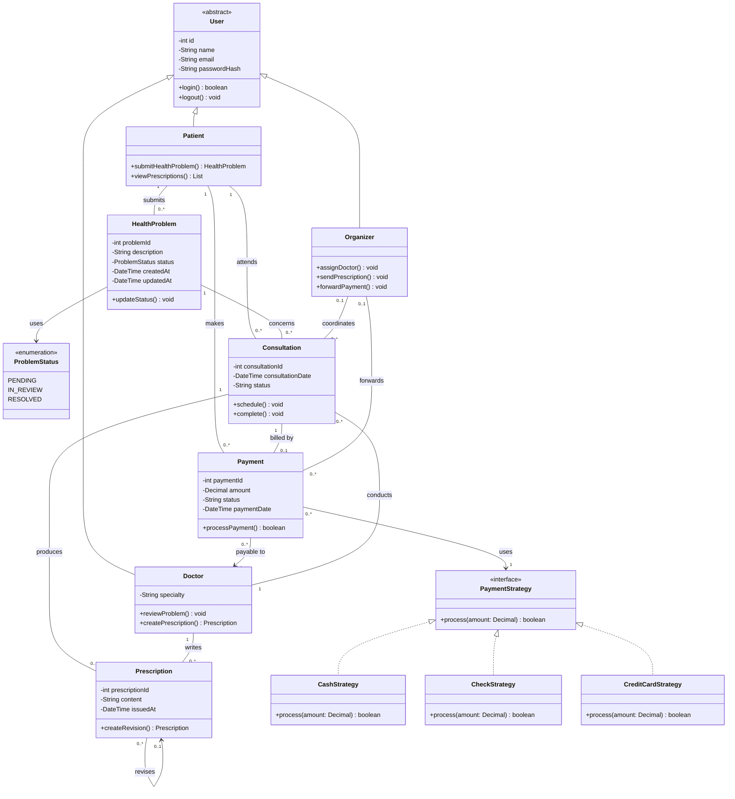

# Hospital Management System — Class Diagram

This UML class diagram models an online hospital management platform.

It covers:
- User roles and inheritance
- Patient health problems and consultations
- Medical prescriptions and their history
- Payment processing using the Strategy design pattern

## UML Class Diagram

## Design Decisions

### Inheritance
Patient, Doctor and Organizer inherit common attributes and
authentication methods from the abstract User class.

### Consultations
The Consultation class allows a patient to consult multiple
doctors for the same health problem.

### Prescriptions
Each consultation can produce a prescription. Prescriptions
may reference earlier prescriptions to preserve revision history.

### Payment Strategy
The Strategy design pattern separates payment processing
from the Payment class.

Cash, check and credit card payments use different strategies.

### Multiplicities
- A patient can submit multiple health problems.
- A patient can attend multiple consultations.
- A doctor can conduct multiple consultations.
- A health problem can lead to multiple consultations.
- Each payment is associated with one consultation.
