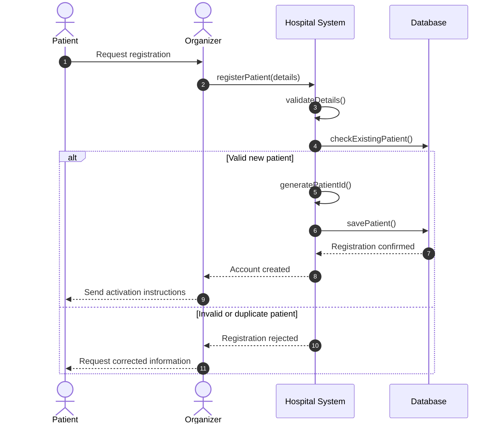
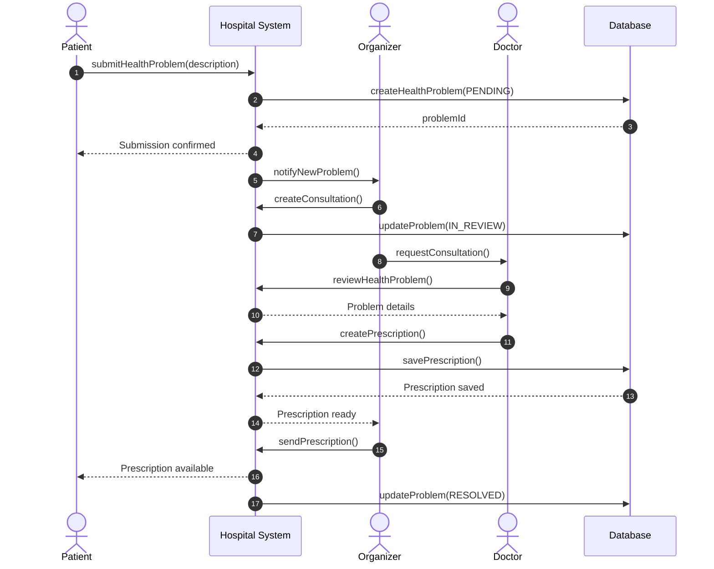
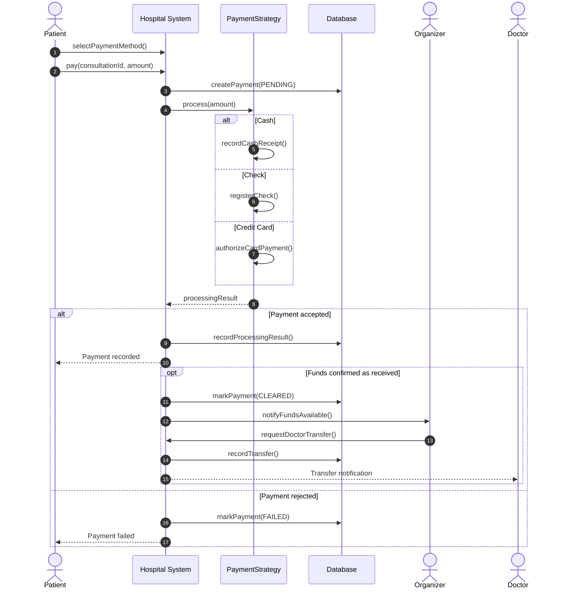

# Hospital Management System — Sequence Diagrams

This document presents three UML sequence diagrams:
1. Patient registration
2. Medical consultation
3. Payment processing

## 1. Patient Registration

The organizer registers a new patient and creates their account.

## 2. Medical Consultation

A patient submits a health problem. The organizer coordinates
the consultation and sends the doctor's prescription.

## 3. Payment Processing

The system delegates payment processing to a PaymentStrategy.

## UML Concepts Used

- **Actors:** external users interacting with the system.
- **Lifelines:** participants in each interaction.
- **Messages:** requests and responses between participants.
- **alt:** alternative flows based on conditions.
- **opt:** optional behavior.
- **Strategy Pattern:** interchangeable payment algorithms.

## Assumptions

- The organizer is responsible for patient registration.
- A problem can involve multiple medical consultations.
- A prescription is made available after a consultation.
- Payment acceptance does not always mean funds have cleared.
- Funds must be confirmed before transferring money to a doctor.
