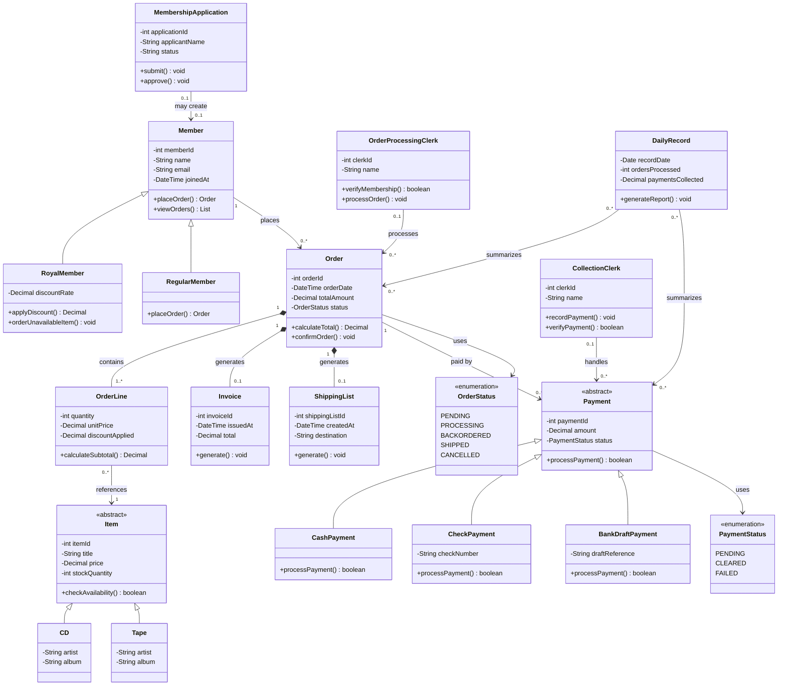

# ABCD Records — Class Diagram

This UML class diagram models a mail-order system for CDs and tapes.

## Complete Class Diagram

## Key UML Concepts

### Inheritance

RoyalMember and RegularMember inherit from Member.

CD and Tape inherit from the abstract Item class.

CashPayment, CheckPayment and BankDraftPayment
inherit from the abstract Payment class.

### Composition

An Order contains one or more OrderLines.

Each OrderLine belongs to exactly one Order.

An OrderLine references one Item and stores
the quantity and historical selling price.

### Associations and Multiplicities

- One member can place multiple orders.
- One order belongs to exactly one member.
- One order contains one or more order lines.
- One item can appear in multiple order lines.
- One order may generate an invoice.
- One order may generate a shipping list.
- One order can have multiple payments.
- One clerk can process multiple orders.

### Royal Membership

Royal members receive discounts and priority processing.

They can also order unavailable items.

Unavailable items can be marked as BACKORDERED
and fulfilled when stock becomes available.

### Payment Processing

Payments can be made using:
- Cash
- Check
- Bank draft

Payment status is tracked to avoid treating
an unconfirmed payment as completed.

## Modeling Assumptions

- Orders contain at least one item once confirmed.
- An order may have multiple payments.
- A pending order may not yet have an assigned clerk.
- A shipping list may be generated after payment confirmation.
- Daily records summarize orders and payments.
