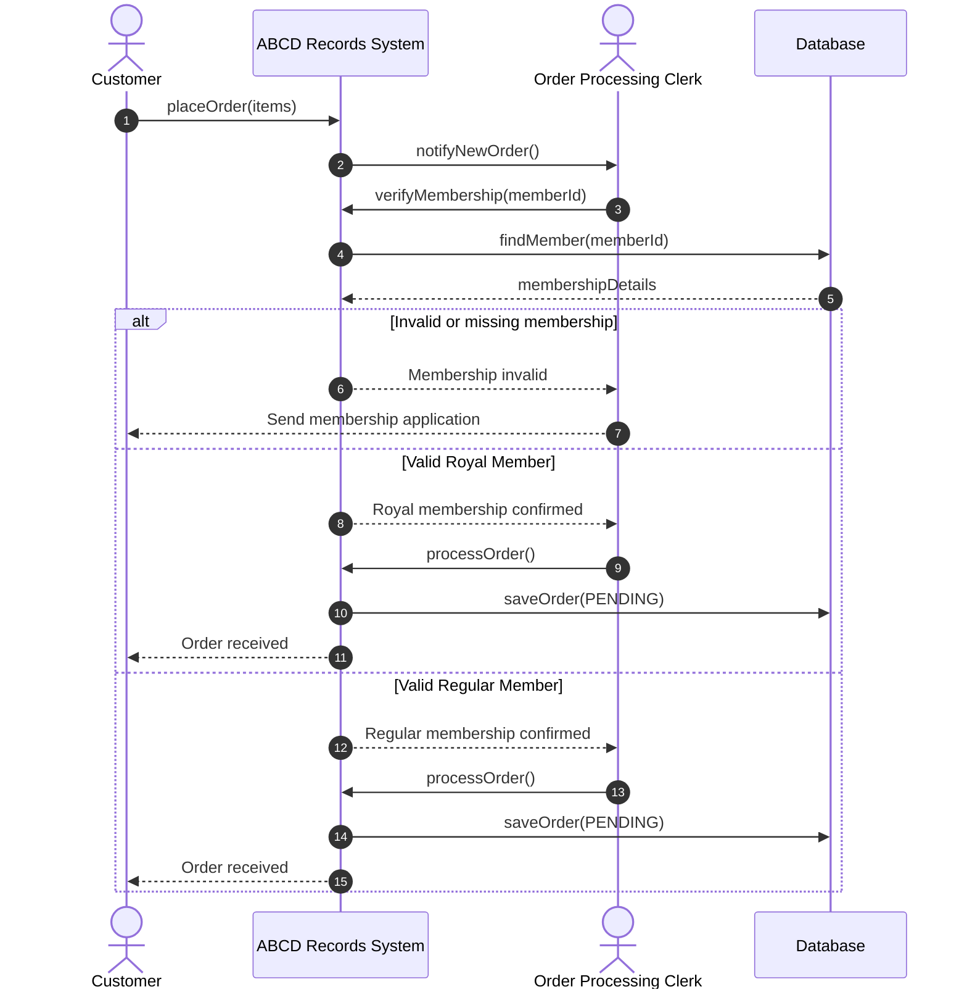
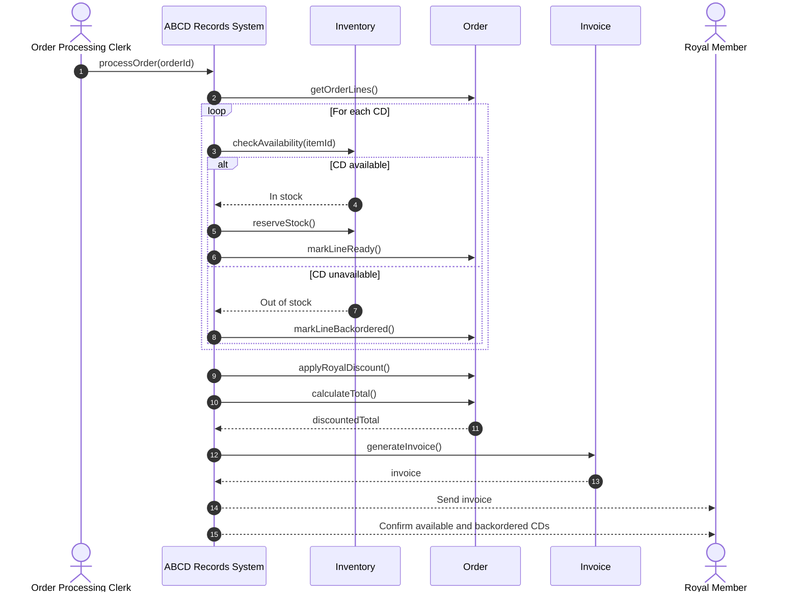
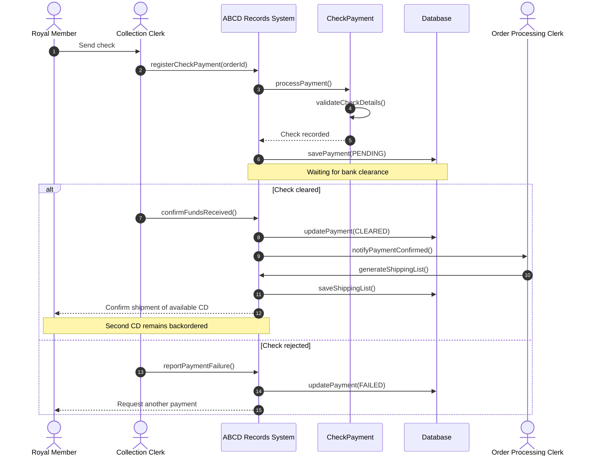

# ABCD Records — Sequence Diagrams

This document presents three UML sequence diagrams for
the ABCD Records mail-order management system.

## 1. Membership Verification and Order Placement

The system verifies membership before accepting an order.

## 2. Royal Member — Stock and Discount Processing

A Royal Member orders two different CDs.
One CD is available, while the other is out of stock.

Royal membership allows ordering unavailable items.

## 3. Check Payment and Shipping

The Royal Member pays by check.

The company waits for the check to clear before
shipping the available CD.

## UML Concepts Demonstrated

- Actors and system participants
- Messages and return messages
- Alternative flows using alt and else
- Repeated actions using loop
- Conditional stock availability
- Royal Member discounts and backorders
- Payment status tracking

## Business Rules and Assumptions

1. Only valid members can place orders.
2. Royal Members receive discounts and priority.
3. Royal Members may order unavailable products.
4. Each CD is checked separately for availability.
5. Unavailable CDs are recorded as backordered.
6. Checks must clear before shipment.
7. Partial shipment is allowed in this model.
8. The remaining CD is shipped when available.

These diagrams are simplified educational models.
