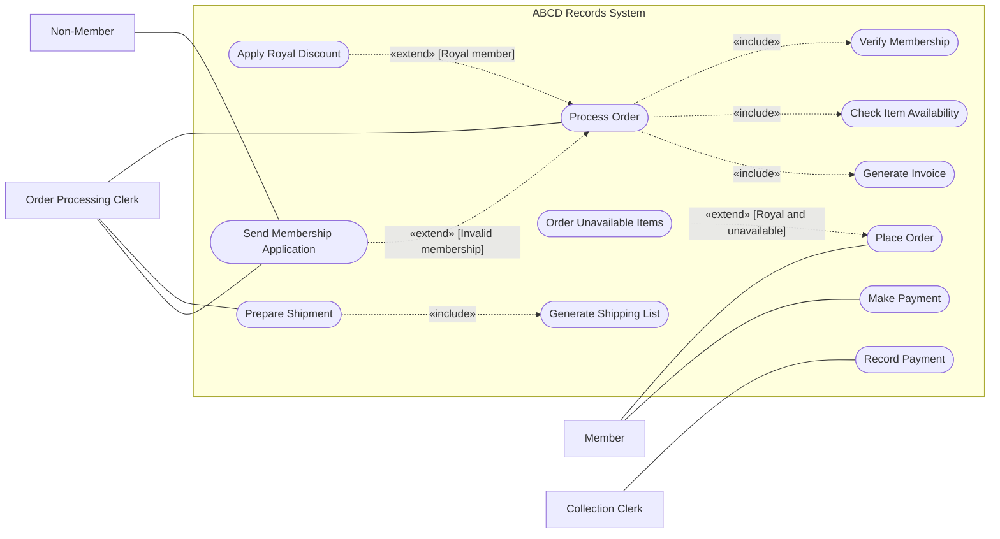

# ABCD Records — Use Case Diagram

## Project Overview

ABCD Records is a mail-order company selling CDs and tapes.

Only registered members can place orders. The company offers
two membership types:

- Regular Members: standard ordering privileges.
- Royal Members: discounts, priority processing, and the
  ability to order unavailable items.

Orders are processed by an Order Processing Clerk.
Payments are handled by a Collection Clerk.

## Use Case Diagram

## Actors

### Member
- Places orders.
- Makes payments.
- May have Regular or Royal membership.

### Non-Member
- Receives a membership application when membership is invalid.

### Order Processing Clerk
- Verifies membership.
- Processes orders.
- Checks product availability.
- Prepares shipments.

### Collection Clerk
- Records and handles customer payments.

## UML Relationships

### Include

An `include` relationship represents required behavior
reused by another use case.

Examples:
- Process Order includes Verify Membership.
- Process Order includes Check Item Availability.
- Prepare Shipment includes Generate Shipping List.

The arrow points toward the included use case.

### Extend

An `extend` relationship represents additional behavior
that occurs only under specific conditions.

Examples:
- Apply Royal Discount extends Process Order.
- Order Unavailable Items extends Place Order.
- Send Membership Application extends Process Order
  when the customer is not a valid member.

The arrow points toward the base use case.

## Important Note

Mermaid does not natively support strict UML use case
diagrams. This flowchart approximates UML actors, use cases,
and relationships so that the diagram renders on GitHub.

The model is a simplified interpretation of the business rules.
In particular, shipping preparation depends on the fulfillment
and payment policies adopted by the company.
